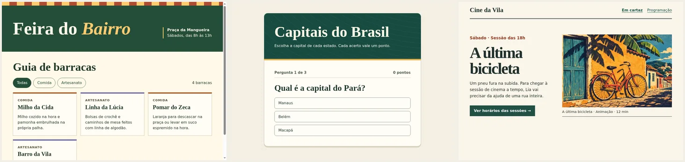
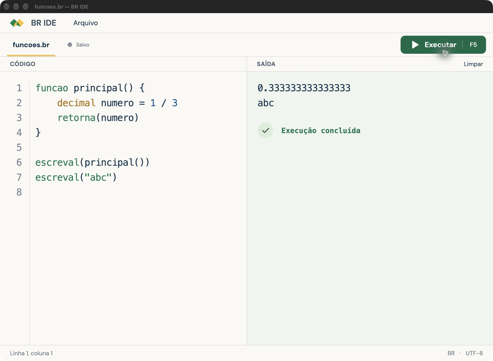

<p align="center">
  
</p>
<h1 align="center">Alumia 🇧🇷</h1>
<p align="center"><strong>Uma linguagem e uma IDE para aprender a programar em português.</strong></p>
<p align="center">
  <a href="#baixe-para-seu-computador"><strong>⬇ Baixar a IDE</strong></a> ·
  <a href="https://github.com/alumia-brasil/alumia-br/archive/refs/heads/main.zip"><strong>📦 Baixar os exemplos</strong></a> ·
  <a href="exemplos/README.md"><strong>📘 Guia de exercícios</strong></a>
</p>

Como um jogo sabe se o seu palpite está perto? E quem paga o centavo que sobra ao dividir a conta da mesa? Na Alumia, essas perguntas viram programas que você pode abrir, ler e mudar. O editor, o executor, o compilador e a documentação já vêm no aplicativo. Depois de baixar a IDE e os exemplos, dá para estudar offline.

[](exemplos/README.md#sites-para-abrir-na-ide)

## 🎮 Escolha um programa para rodar

Extraia o ZIP dos exemplos. Na IDE, use **Arquivo → Abrir**, selecione um arquivo `.br` na pasta `exemplos` e aperte **F5**. Quando o programa fizer uma pergunta, digite a resposta na aba **Terminal** e pressione **Enter**.

| Programa | Experimente |
| --- | --- |
| [Calculadora](exemplos/calculadora.br) | Digite `3`, `/` e `2`, uma resposta por vez. O resultado é `1.5`. Troque o segundo número por zero para descobrir como o programa trata essa divisão. |
| [Adivinhe o número](exemplos/adivinhacao.br) | Comece com `50`. Use as pistas **maior** e **menor** para descobrir o número de 1 a 100 em poucas tentativas. |
| [Racha-conta](exemplos/racha_conta.br) | Divida R$ 100 com 10% de gorjeta por três pessoas. Duas pagam R$ 36,67 e uma paga R$ 36,66. Veja onde entra o último centavo. |
| [Quiz das capitais](exemplos/quiz_capitais.br) | Responda às cinco perguntas. Para o Pará, tanto `Belém` quanto `BELÉM` valem um ponto. |
| [Caixa do mercadinho](exemplos/mercadinho.br) | Digite `4.25`, `12.90` e `0.85`. Feche a compra com `0` e confira o total de R$ 18,00 e o item mais caro. |

Para começar com um laço curto, abra a [tabuada](exemplos/tabuada.br). Para praticar listas e funções em etapas, siga a [oficina de programação](exemplos/README.md#oficina-guiada).

## 🌐 Da IDE para o navegador

- **Feira do Bairro.** Clique em **Comida** ou **Artesanato** para filtrar o catálogo. Depois, adicione uma barraca ao HTML e veja o filtro encontrá-la. [Abrir o projeto da feira](exemplos/sites/feira-do-bairro/README.md)
- **Quiz do Brasil.** Escolha as capitais pelos botões, acompanhe o placar e recomece a rodada. O guia mostra como escrever sua própria pergunta em JavaScript. [Abrir o quiz web](exemplos/sites/quiz-do-brasil/README.md)
- **Cine da Vila.** Siga o link do cartaz para a programação de sábado. A rota `/programacao/` abre outra página, com os horários das sessões e a mesma folha de estilos. [Abrir o cineclube](exemplos/sites/cine-da-vila/README.md)

Este é o servidor inteiro do Cine da Vila. Ele registra as duas páginas e serve a pasta `publico` na porta `8083`.

```br
rota.get("/")
rota.get("/programacao")
servidor_http(8083, "publico")
```

Em **Arquivo → Abrir pasta**, escolha a pasta do projeto que contém `servidor.br`. No rodapé, clique em **Servidor web → Iniciar servidor web → Abrir no navegador**. Ao salvar uma mudança no HTML, CSS ou JavaScript pela IDE, a página aberta recarrega. [Tutorial para criar seu primeiro site](exemplos/site/README.md)

## ✍️ Seu primeiro programa

Em **Arquivo → Novo**, substitua o conteúdo do editor por este código. Ele lê um número e usa `%` para calcular o resto da divisão por dois.

```br
inteiro numero = para_inteiro(leia("Digite um número inteiro: "))

se (numero % 2 == 0) {
    escreval(numero, " é par.")
} senao {
    escreval(numero, " é ímpar.")
}
```

Clique em **Executar**, digite `7` e pressione **Enter**. O Terminal mostra **7 é ímpar.** Rode outra vez com `0` para testar o outro caminho. [Abrir o arquivo par ou ímpar](exemplos/par_ou_impar.br)

<p align="center"></p>

Se aparecer um erro de sintaxe, clique na mensagem em **Problemas** para ir ao trecho do código. Quando quiser levar seu programa para fora da IDE, use **Compilar** e escolha onde salvar o executável. [Guia da IDE](docs/ide.md) · [Como compilar](docs/ide.md#compilacao) · [Referência da linguagem](LINGUAGEM.md)

## Baixe para seu computador

| Sistema | Pacote da versão 0.1.0 |
| --- | --- |
| Windows x64 | [Instalador para Windows (.exe)](https://github.com/alumia-brasil/alumia-br/releases/download/v0.1.0/Alumia-Setup.exe) |
| macOS 14 ou posterior · chip Apple M | [Aplicativo para Apple Silicon (.zip)](https://github.com/alumia-brasil/alumia-br/releases/download/v0.1.0/Alumia-macOS-arm64.zip) |
| macOS 14 ou posterior · processador Intel | [Aplicativo para Mac Intel (.zip)](https://github.com/alumia-brasil/alumia-br/releases/download/v0.1.0/Alumia-macOS-x64.zip) |
| Linux x64 | [Aplicativo para Linux (.tar.gz)](https://github.com/alumia-brasil/alumia-br/releases/download/v0.1.0/Alumia-Linux-x64.tar.gz) |

O instalador do **Windows** ainda está sem assinatura de editor. No **macOS**, a versão usa assinatura ad hoc e aguarda notarização. O Gatekeeper bloqueou a abertura no teste com macOS 27.3. A execução em Mac Intel ainda precisa de validação. O guia inclui a instalação pelo Homebrew e a verificação do download. [Instruções por sistema](docs/instalacao.md) · [Página da versão](https://github.com/alumia-brasil/alumia-br/releases/latest)

## Por dentro da Alumia


A linguagem e o executor usam C11. A interface usa TypeScript e Electron. O Zig acompanha a IDE para transformar programas BR em executáveis no seu computador.

Testou um exercício em sala de aula, encontrou um erro ou tem uma ideia para o próximo exemplo? Conte o que tentou em [Dúvidas e sugestões](SUPPORT.md). A Alumia é distribuída sob a [PolyForm Noncommercial 1.0.0](LICENSE). Consulte também os [avisos de terceiros](THIRD_PARTY_NOTICES.md).
