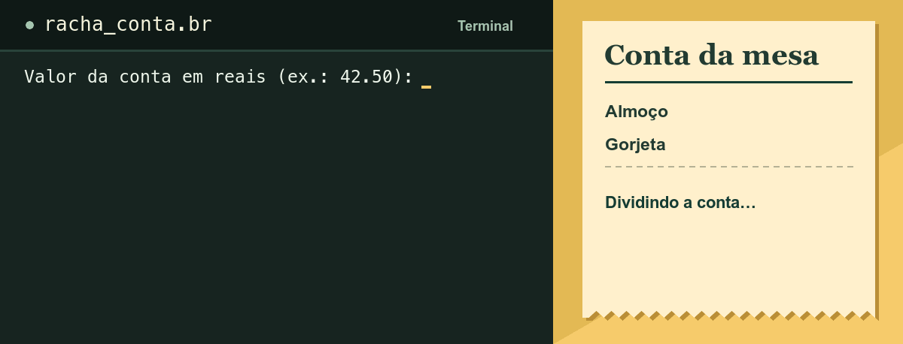
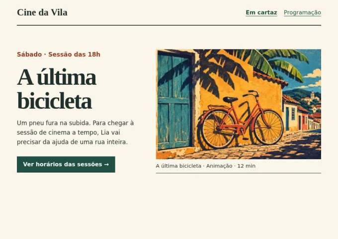

<h1 align="center">
  
</h1>

<p align="center"><strong>Uma linguagem brasileira para escrever jogos, fazer contas e servir páginas web.</strong><br>
Editor, terminal, compilador e documentação vêm juntos. Dá para estudar offline desde a primeira aula.</p>

<p align="center">
  <a href="#baixe-para-seu-computador"></a>
  <a href="https://github.com/alumia-brasil/alumia-br/archive/refs/heads/main.zip"></a>
</p>
<p align="center"><a href="#seu-primeiro-programa">Primeiro programa</a> · <a href="#projetos-para-o-terminal">Jogos e exercícios</a> · <a href="#sites-para-abrir-no-navegador">Galeria de sites</a> · <a href="LINGUAGEM.md">Referência da linguagem</a></p>

<a name="seu-primeiro-programa"></a>

## Quem paga o último centavo?

O almoço deu R$ 100. A mesa deixou 10% de gorjeta. Três pessoas vão dividir R$ 110. Se cada uma pagar R$ 36,67, a mesa paga R$ 110,01. Como um programa resolve isso?

<picture>
  <source media="(prefers-reduced-motion: reduce)" srcset="imagens/racha-conta.webp">
  
</picture>

**Rode essa conta.** Extraia o ZIP dos exemplos, abra `exemplos/racha_conta.br` em **Arquivo → Abrir** e aperte **F5**. No Terminal, digite `100`, `10` e `3`, uma resposta por vez. Depois experimente com quatro pessoas. [Ver o programa completo](exemplos/racha_conta.br) · [Ver a demonstração sem animação](imagens/racha-conta.webp)

O truque está em dividir **centavos inteiros**. Você pode isolar a ideia em **Arquivo → Novo** e executar estas quatro linhas.

```br
inteiro centavos = 11000
inteiro pessoas = 3
escreval("Centavos por pessoa: ", centavos / pessoas)
escreval("Centavos que sobram: ", centavos % pessoas)
```

Cada pessoa começa com `3666` centavos. O resto é `2`, então duas pessoas pagam um centavo a mais. As três parcelas somam exatamente R$ 110,00.

<a name="escolha-um-projeto-para-abrir-agora"></a>

## Projetos para o Terminal

| Abra com F5 | Faça uma mudança e veja o que acontece |
| --- | --- |
| [**Adivinhe o número**](exemplos/adivinhacao.br) | Dê um palpite entre 1 e 100. Use a pista *maior* ou *menor* para escolher o próximo e descubra onde o `enquanto` termina. |
| [**Calculadora**](exemplos/calculadora.br) | Experimente `3 / 2` e depois `3 / 0`. A primeira conta devolve `1.5`. A segunda aciona a mensagem de divisão por zero. |
| [**Quiz das capitais**](exemplos/quiz_capitais.br) | Responda `BELÉM` à pergunta sobre o Pará. Veja como `minusculo` reconhece a resposta e soma um ponto. |
| [**Caixa do mercadinho**](exemplos/mercadinho.br) | Lance `4.25`, `12.90` e `0.85`. Digite `0` para fechar a compra. O caixa mostra R$ 18,00 e identifica o segundo item como o mais caro. |

Quer um exercício menor? Descubra se `-7` é [par ou ímpar](exemplos/par_ou_impar.br) ou leve a [tabuada do sete](exemplos/tabuada.br) de 10 até 12 multiplicações.

**Em sala de aula**, a oficina tem três etapas com entradas e resultados esperados. Comece contando vagas, faça a turma aceitar ou recusar uma reserva e termine somando lugares em uma lista de turmas. [Abrir a oficina guiada](exemplos/README.md#oficina-guiada)

<a name="faça-um-site-rodar-no-navegador"></a>

## Sites para abrir no navegador

<table>
<tr>
<td width="33%" valign="top"><a href="exemplos/sites/feira-do-bairro/README.md"><br><strong>Feira do Bairro →</strong></a><br>Adicione uma barraca ao HTML e encontre-a pelo filtro.</td>
<td width="33%" valign="top"><a href="exemplos/sites/quiz-do-brasil/README.md"><br><strong>Quiz do Brasil →</strong></a><br>Escolha uma capital e crie a próxima pergunta no JavaScript.</td>
<td width="33%" valign="top"><a href="exemplos/sites/cine-da-vila/README.md"><br><strong>Cine da Vila →</strong></a><br>Siga o cartaz até os horários e mude uma sessão.</td>
</tr>
</table>

Em **Arquivo → Abrir pasta**, escolha a pasta do site que contém `servidor.br`. No rodapé, clique em **Servidor web → Iniciar servidor web → Abrir no navegador**. Salve uma mudança no HTML, CSS ou JavaScript pela IDE e a página aberta recarrega.

O **Cine da Vila** usa este servidor inteiro. O link `/programacao/` entrega a página `publico/programacao/index.html`.

```br
rota.get("/")
rota.get("/programacao")
servidor_http(8083, "publico")
```

Para começar um site seu, **Arquivo → Novo projeto web** cria a página inicial e os arquivos de estilo e script. O tutorial ensina a criar a segunda rota e conferir o resultado no navegador. [Criar meu primeiro site](exemplos/site/README.md)

## Conheça a IDE


- **Escreva e rode.** Digite `esc` e pressione **Tab** para completar o comando. **F5** executa o que está no editor, inclusive antes de salvar.
- **Entenda o erro.** Clique na mensagem em português na aba **Problemas**. O editor seleciona o trecho correspondente. As respostas a `leia()` e a saída de `escreval()` ficam no **Terminal**.
- **Leve o programa com você.** Em **Compilar**, escolha nome e pasta. A IDE salva o `.br` e o executável para o mesmo sistema e arquitetura. Para levar um site compilado, copie também a pasta `publico/` ao lado do binário.
- **Estude offline.** O menu **Documentação** reúne 52 exemplos em 16 assuntos. Em **Exibir**, dá para ajustar as fontes do editor e do Terminal separadamente.

[Guia da IDE e atalhos](docs/ide.md) · [Compilar um executável](docs/ide.md#compilacao) · [Todos os exemplos](exemplos/README.md)

## Baixe para seu computador

A versão **0.1.0** já inclui o executor e as ferramentas de compilação. Basta instalar o pacote do seu sistema para escrever e rodar programas BR.

| Sistema | Download |
| --- | --- |
| **Windows x64** | [Instalador .exe](https://github.com/alumia-brasil/alumia-br/releases/download/v0.1.0/Alumia-Setup.exe) |
| **macOS 14 ou posterior** | [Apple Silicon · chip M](https://github.com/alumia-brasil/alumia-br/releases/download/v0.1.0/Alumia-macOS-arm64.zip) · [Processador Intel](https://github.com/alumia-brasil/alumia-br/releases/download/v0.1.0/Alumia-macOS-x64.zip) |
| **Linux x64** | [Pacote .tar.gz](https://github.com/alumia-brasil/alumia-br/releases/download/v0.1.0/Alumia-Linux-x64.tar.gz) |

**Primeira abertura.** O instalador Windows ainda está sem assinatura de editor. No Mac, a versão tem assinatura ad hoc e aguarda notarização. O Gatekeeper bloqueou a abertura no teste com macOS 27.3. A execução em Mac Intel ainda precisa de validação. [Instalação por sistema, Homebrew e SHA-256](docs/instalacao.md) · [Página da versão](https://github.com/alumia-brasil/alumia-br/releases/latest)

<a name="como-a-alumia-funciona"></a>

## Por dentro da Alumia


**Executar** usa o executor nativo da linguagem. **Compilar** gera C e usa o Zig incluído para produzir o binário. A interface é feita em TypeScript e Electron. A linguagem tem listas tipadas, funções com parâmetros e retorno, comparações, condições e laços. [Consultar a sintaxe e os limites da versão](LINGUAGEM.md)

<details>
<summary><strong>Quando a divisão preserva as casas decimais?</strong></summary>

Em `inteiro metade = 3 / 2`, o valor é `1`. Em `decimal metade = 3 / 2`, é `1.5`. Para imprimir a fração diretamente, use `escreval(3.0 / 2)`. O separador decimal da linguagem é o ponto.

</details>

<a name="participe"></a>

<details>
<summary><strong>Como contribuir ou sugerir um exercício?</strong></summary>

Este repositório reúne os downloads, os guias e o código dos exemplos. Correções nos guias e exercícios podem ser enviadas por pull request. Para sugerir uma atividade ou relatar um erro, conte o que tentou e qual resultado esperava. [Abrir uma issue](https://github.com/alumia-brasil/alumia-br/issues/new/choose) · [Suporte](SUPPORT.md)

</details>

A Alumia é distribuída sob a licença [PolyForm Noncommercial 1.0.0](LICENSE). As licenças dos componentes distribuídos com a IDE estão nos [avisos de terceiros](THIRD_PARTY_NOTICES.md).
