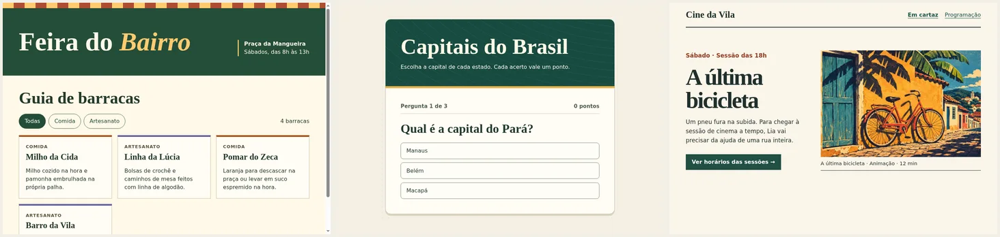

# Exemplos de programação em Alumia

**Para acompanhar**, [baixe os exemplos em ZIP](https://github.com/alumia-brasil/alumia-br/archive/refs/heads/main.zip), extraia a pasta e use **Arquivo → Abrir** na Alumia para escolher um arquivo `.br`. Se preferir digitar, use **Arquivo → Novo** e substitua o conteúdo do editor. **Executar** ou **F5** roda o exemplo. A saída e os pedidos de entrada ficam na aba **Terminal**.

## Programas básicos

| Abra na IDE | Digite no Terminal | Confira o resultado |
| --- | --- | --- |
| [Calculadora de quatro operações](calculadora.br) | Digite `3`, depois `/` e depois `2`. Aperte **Enter** após cada resposta. | `Resultado: 1.5`. Execute outra vez e tente dividir por zero para ver como o programa trata esse caso. |
| [Par ou ímpar](par_ou_impar.br) | Digite `-7`. Depois rode de novo com `0`. | Primeiro aparece `-7 é ímpar.` e depois `0 é par.`. O operador `%` calcula o resto da divisão. |
| [Tabuada](tabuada.br) | Digite `7`. | Aparecem dez linhas, de `7 x 1 = 7` até `7 x 10 = 70`. Troque o limite do laço por `12` para chegar até `7 x 12 = 84`. |

Na calculadora, use `*` para multiplicar e `/` para dividir. Para digitar uma fração decimal, use ponto, como em `2.5`. Tente multiplicar esse valor por `4` e confira se o resultado é `10`.

## Jogos e programas do dia a dia

| Abra e execute com F5 | Digite no Terminal | O que observar |
| --- | --- | --- |
| [Adivinhe o número](adivinhacao.br) | Comece por `50`. Se a pista disser **maior**, tente `75`. Se disser **menor**, tente `25`. | `sorteia(1, 100)` escolhe o segredo no início da partida. O jogo conta os palpites válidos e termina quando você acerta. |
| [Racha-conta](racha_conta.br) | Digite `100` para a conta, `10` para a gorjeta em porcentagem e `3` para o número de pessoas. | O total é **R$ 110,00**. Duas pessoas pagam **R$ 36,67** e uma paga **R$ 36,66**. O programa distribui até o último centavo. |
| [Quiz das capitais](quiz_capitais.br) | Responda `Salvador`, `Natal`, `BELÉM`, `curitiba` e `Recife`, uma cidade por vez. | A pontuação é **4 de 5**. Na segunda pergunta, o programa mostra a resposta correta, Fortaleza. Ele aceita maiúsculas e minúsculas. |
| [Caixa do mercadinho](mercadinho.br) | Digite três preços, `4.25`, `12.90` e `0.85`. Para fechar a compra, digite `0`. | O total é **R$ 18,00**. O segundo item, de **R$ 12,90**, é o mais caro. Experimente iniciar outra compra e digitar `0` logo de cara. |

## Sites para abrir na IDE



Extraia o [ZIP dos exemplos](https://github.com/alumia-brasil/alumia-br/archive/refs/heads/main.zip). Em **Arquivo → Abrir pasta**, escolha a pasta do site que contém o `servidor.br`. No rodapé, abra **Servidor web → Iniciar servidor web → Abrir no navegador**. Cada guia traz uma mudança pequena para você fazer e conferir ao salvar.

| Projeto | Experimente no navegador |
| --- | --- |
| [Meu primeiro site](site/README.md) | Digite seu nome no formulário e siga o tutorial para criar a página `/agenda/`. |
| [Feira do Bairro](sites/feira-do-bairro/README.md) | Alterne entre **Comida** e **Artesanato**. Depois, cadastre uma barraca no HTML e veja o filtro encontrá-la. |
| [Quiz do Brasil](sites/quiz-do-brasil/README.md) | Escolha as capitais pelos botões, veja a correção e jogue outra rodada. O guia mostra como escrever sua própria pergunta em JavaScript. |
| [Cine da Vila](sites/cine-da-vila/README.md) | Siga o link do cartaz para `/programacao/` e altere o horário de uma sessão. As duas páginas têm rotas próprias e usam o mesmo CSS. |

## Oficina guiada

Imagine que você organiza oficinas no seu bairro. Primeiro, descubra quantos lugares estão livres. Depois, pergunte quantas vagas uma pessoa quer reservar. Por fim, some os lugares disponíveis em várias turmas. Cada etapa é um programa independente.

### 1. Quantos lugares sobraram?

Abra [oficina/vagas.br](oficina/vagas.br). Cada variável guarda um valor inteiro. A subtração dentro de `escreval` calcula o resultado e o mostra na mesma linha do texto.

```br
inteiro capacidade = 20
inteiro inscritos = 17

escreval("Vagas livres: ", capacidade - inscritos)
```

**Confira no Terminal.** Com 17 inscritos, aparece `Vagas livres: 3`. Troque `17` por `20` e rode outra vez. Agora aparece `Vagas livres: 0`.

### 2. O pedido cabe na turma?

Abra [oficina/inscricao.br](oficina/inscricao.br). Agora o programa espera uma resposta. Digite um número inteiro no **Terminal** e aperte **Enter**. Rode de novo para tentar outro pedido.

```br
inteiro vagas = 3
inteiro pedido = para_inteiro(leia("Quantas vagas você quer reservar? "))

se (pedido >= 1 e pedido <= vagas) {
    escreval("Reserva confirmada. Vagas restantes: ", vagas - pedido)
} senao {
    escreval("Escolha de 1 a ", vagas, " vagas.")
}
```

`leia` devolve texto. `para_inteiro` transforma a resposta em um número. A palavra `e` exige que duas condições sejam verdadeiras ao mesmo tempo. O pedido precisa ser de pelo menos uma vaga e caber na turma.

| Digite | O que deve aparecer |
| --- | --- |
| `2` | `Reserva confirmada. Vagas restantes: 1` |
| `3` | `Reserva confirmada. Vagas restantes: 0` |
| `4` ou `0` | `Escolha de 1 a 3 vagas.` |

**Experimente.** Mude a quantidade disponível para `5` e peça `4` vagas. O mesmo pedido que antes era recusado agora deixa uma vaga livre.

### 3. E quando há mais de uma turma?

Abra [oficina/turmas.br](oficina/turmas.br). As três turmas têm 20 lugares cada uma. Os números da lista são as inscrições de cada turma, na ordem.

```br
funcao inteiro vagas_livres(inteiro capacidade, inteiro inscritos) {
    retorna(capacidade - inscritos)
}

lista<inteiro> inscritos = [17, 20, 12]
inteiro total = 0

para (inteiro i = 0; i < tamanho(inscritos); i = i + 1) {
    total = total + vagas_livres(20, inscritos[i])
}

escreval("Total de vagas livres: ", total)
```

A primeira posição da lista é `0`, então `inscritos[0]` vale `17`. A cada volta do `para`, a função `vagas_livres` devolve a diferença para uma turma. O total passa por 3, 3 e 11. A saída é `Total de vagas livres: 11`.

**Experimente.** Na lista, troque `12` por `15`. Antes de executar, tente prever o total. A última turma passa a ter cinco lugares livres, e o programa mostra `Total de vagas livres: 8`.

## Escolha outro exemplo

| Quero praticar | Programa | O que observar |
| --- | --- | --- |
| Escrever no Terminal | [ola.br](ola.br) | Mostra `Olá Brasil` e depois `30`. Mude o nome e rode de novo. |
| Comentar meu código | [comentarios.br](comentarios.br) | Altere o texto depois de `//`. A saída continua sendo `ok` e `42`. |
| Entender a ordem das contas | [expressoes.br](expressoes.br) | Compare as duas primeiras linhas da saída. `2 + 3 * 4` dá `14`, enquanto `(2 + 3) * 4` dá `20`. |
| Declarar variáveis do mesmo tipo | [declaracoes_multiplas.br](declaracoes_multiplas.br) | Largura, altura e profundidade aparecem na mesma declaração. Dobre a largura e veja o volume dobrar. |
| Escolher entre dois valores | [ternario.br](ternario.br) | Mude a idade de `18` para `17`. A primeira linha passa de `adulto` para `menor de idade`. |
| Devolver um resultado | [funcoes.br](funcoes.br) | `principal()` devolve um terço. O código que fez a chamada imprime o valor e depois escreve `abc`. |
| Encerrar uma função | [retorna.br](retorna.br) | O primeiro `escreval` roda. A mensagem depois de `retorna(0)` fica fora da saída. |
| Sortear e comparar valores | [utilitarias.br](utilitarias.br) | Rode algumas vezes. As notas mínima e máxima continuam iguais, e o dado pode cair de 1 a 6. |
| Fazer uma pausa | [espera.br](espera.br) | A mensagem só aparece após uma pausa sorteada de 1 a 20 segundos. Para experimentar uma pausa curta, use `espera(0.25)`. |
| Combinar entrada, lista e repetição | [basico.br](basico.br) | Digite `Ana`, `18` e `8.5`, uma resposta por vez. Procure `Olá, ANA!` e `Média: 9` na saída. |

[Voltar ao início](../README.md) · [Consultar a linguagem](../LINGUAGEM.md) · [Usar a IDE](../docs/ide.md)
